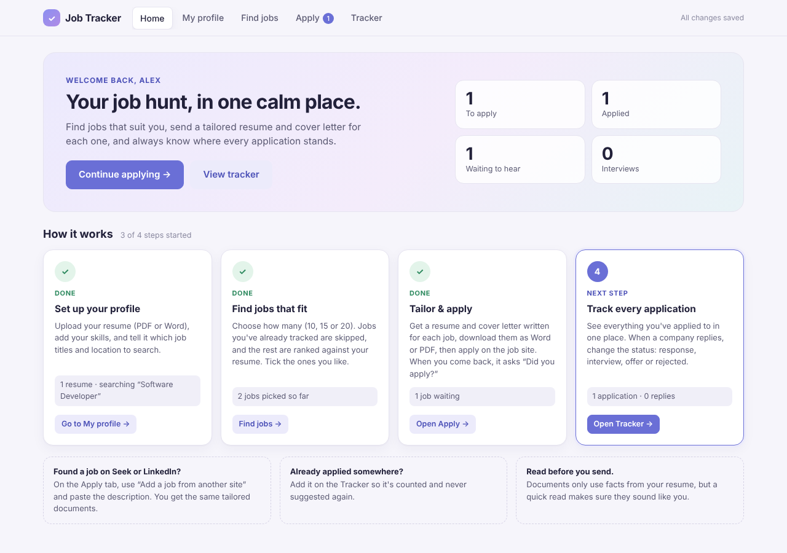
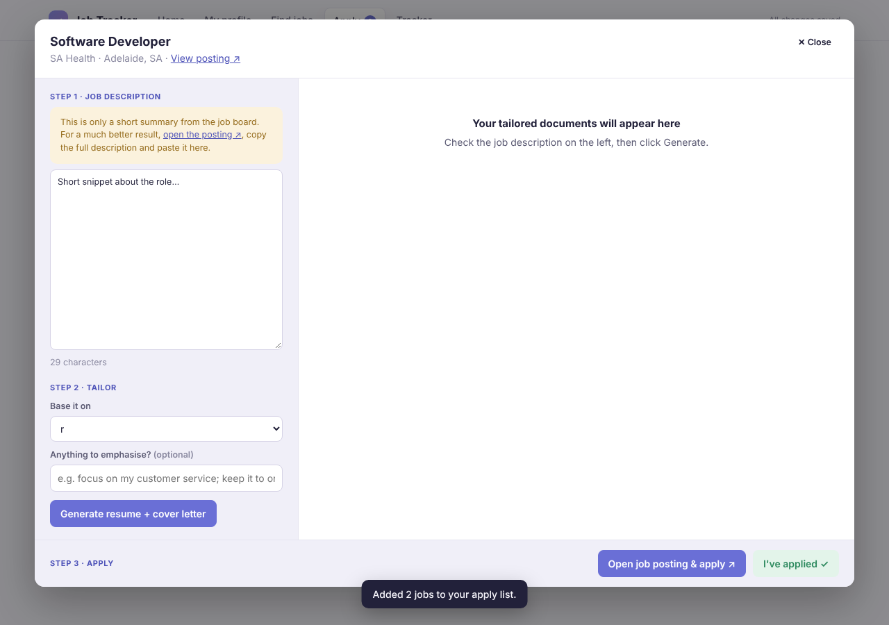

# Job Tracker

Find jobs that suit you, get a resume and cover letter tailored to each one, and keep track of every application in one place. It runs on your own computer, and your resumes and job data never leave it, except for the text sent to Claude when you ask it to tailor a document.



## What it does

1. **My profile.** Upload your resumes (PDF, Word or text), add your skills and notes, and set the job titles and location to search for.
2. **Find jobs.** Searches listings from many job sites (through [Adzuna](https://www.adzuna.com/)). Jobs already in your tracker are skipped, and the rest are ranked against your resume by Claude. You choose 10, 15, 20 or 25, then tick the ones you like.
3. **Apply.** For each job, Claude writes a tailored resume and cover letter using **only facts from your resumes**. It also shows what you match, any gaps, and anything the ad asks for, such as a police check or selection criteria. You download Word (.docx) or PDF, apply on the job site, and when you come back it asks **"Did you apply?"**
4. **Tracker.** A dashboard of every job: totals, applications per week, response rate and a table where you update the status (applied, got a response, interview, offer, rejected). Jobs with no reply after 2 weeks get a "Follow up?" tag. You can export everything to CSV.



## Quick start

### 1. Install Node.js

You need **[Node.js](https://nodejs.org/) 18 or newer**. Download the **LTS** installer from nodejs.org and run it, then open a **new** terminal window and check it worked:

```bash
node --version
```

There's nothing else to install (no `npm install` needed).

### 2. Download the project

```bash
git clone https://github.com/sudeshna-khanzode/job-tracker.git
cd job-tracker
```

### 3. Create your settings file

On **Mac or Linux**:

```bash
cp .env.example .env
open -e .env
```

On **Windows** (Command Prompt):

```bat
copy .env.example .env
notepad .env
```

Add your keys after the `=` signs (see [Getting your keys](#getting-your-keys)), then save and close the file.

### 4. Start it

```bash
npm start
```

Open **http://localhost:3000** in your browser. To stop the server, press `Ctrl+C` in the terminal. Next time, just `cd job-tracker` and run `npm start` again. Your data is kept.

## Getting your keys

Both go in the `.env` file. `.env` is listed in `.gitignore`, so your keys are never committed.

### Claude API key (for tailoring and ranking)

1. Go to [console.anthropic.com](https://console.anthropic.com/) and sign in.
2. Add some credit under **Billing**. API usage is billed separately from a Claude.ai subscription.
3. Under **API keys**, create a key and paste it into `.env`:
   ```
   ANTHROPIC_API_KEY=sk-ant-...
   ```

By default tailoring uses `claude-sonnet-5-5` and quick tasks such as ranking use `claude-haiku-5-5`. You can change either in `.env`. Each tailored resume and cover letter is a single request, usually costing a few cents. Check [current pricing](https://www.anthropic.com/pricing).

### Adzuna keys (for job search)

1. Register at [developer.adzuna.com](https://developer.adzuna.com/).
2. Your **Application ID** and **Application Key** are on the dashboard. Add them to `.env`:
   ```
   ADZUNA_APP_ID=...
   ADZUNA_APP_KEY=...
   ```

New Adzuna accounts start on a small trial of test calls (25 at the time of writing). Ongoing use needs a paid Adzuna plan, and Adzuna shows prices in its dashboard. Each position you search uses one call, so search one or two positions at a time while on the trial.

Restart the server after editing `.env`. If a key is missing, the Home page tells you which one.

**Without the keys:** the tracker still works. You can add jobs by hand ("Add a job from another site"), track statuses and export. Search needs Adzuna and tailoring needs Claude.

## Tips

- **Paste the full job description.** Adzuna only returns a short summary of each job. Before generating documents, open the posting, copy the whole description and paste it into the box. The results get much better.
- **Jobs from Seek, LinkedIn or company sites** can be added on the Apply tab with "Add a job from another site". You get the same tailored documents.
- **Already applied somewhere?** Add it on the Tracker so it's counted and never suggested again.
- **Read before you send.** Claude is told never to invent jobs, dates, qualifications or numbers. It still makes mistakes, so check each document reads like you.

## Your data

Everything is saved in `data/tracker.json`: your profile, resume text, jobs and generated documents. The `data/` folder is in `.gitignore`, so it is never committed.

- **Back up:** copy `data/tracker.json` somewhere safe.
- **Move to another computer:** copy it into the same place in the other project folder.
- **Start fresh:** stop the server and delete the file.

To store data somewhere else, such as a synced folder, set `DATA_DIR` in `.env`.

**Privacy:** the server only listens on `127.0.0.1`, so other devices can't connect to it, and it refuses API calls from other websites. When you tailor a document, your resume text and the job description are sent to the Claude API. When you search, your job titles and location are sent to Adzuna. Nothing else leaves your computer.

## Troubleshooting

| Problem | Fix |
|---|---|
| `command not found: npm` | Node.js isn't installed, or the terminal was opened before installing it. Install it from nodejs.org, then open a new terminal window. |
| `Port 3000 is already in use` | Add `PORT=3001` to `.env` and open http://localhost:3001 |
| "Can't reach the Job Tracker server" | The terminal running `npm start` was closed. Start it again and reload the page. |
| "The Claude API rejected your API key" | Check `ANTHROPIC_API_KEY` in `.env`, with no quotes or spaces, then restart. |
| "Model not found" | Your account may not have that model. Set `ANTHROPIC_MODEL` to one listed in the console. |
| "Adzuna rejected your app ID or key" | Check both Adzuna values in `.env`, then restart. |
| A PDF resume comes out empty or garbled | It may be a scanned image. Use "Or paste resume text" on My profile instead. |
| `.doc` file won't upload | Save it as `.docx` or PDF first. |

## Project structure

```
job-tracker/
├── server.js            # local web server and API (no dependencies)
├── lib/
│   ├── anthropic.js     # Claude Messages API client
│   ├── adzuna.js        # Adzuna job search client
│   ├── store.js         # saves data to data/tracker.json
│   ├── json.js          # reads JSON out of model replies
│   └── env.js           # loads .env
├── public/              # the app (plain HTML/CSS/JS, no build step)
│   ├── index.html
│   ├── styles.css
│   ├── js/
│   │   ├── app.js       # screens and logic
│   │   ├── platform.js  # connects the app to the local server
│   │   └── docs.js      # builds .docx and .pdf resumes and cover letters
│   └── vendor/          # bundled libraries (see vendor/README.md)
├── test/                # npm test
├── .env.example
└── data/                # your saved data (created on first run, not committed)
```

## Development

```bash
npm test     # runs the tests in test/ with Node's built-in test runner
```

The front end is plain JavaScript with no build step. Edit a file in `public/` and reload the browser. Restart the server after changing `server.js` or anything in `lib/`.

## License

MIT. Bundled third-party libraries keep their own licenses; see [public/vendor/README.md](public/vendor/README.md).
